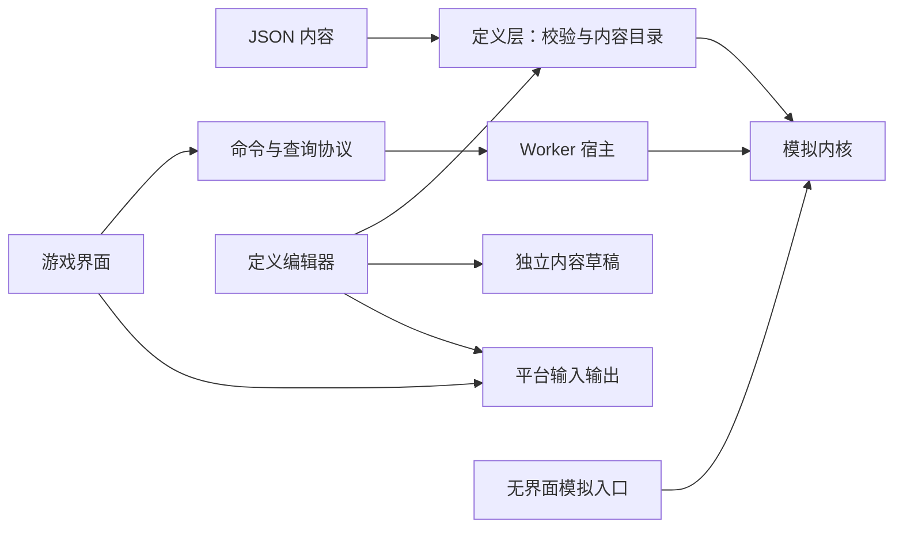

# 网页整体架构与目录规划

记录日期：2026 年 11 月 9 日；更新日期：2026 年 11 月 17 日。`web/` 已开始落地，当前实际范围及暂定规则见 [实施记录](implementation-notes.md)。下文仍是完整游戏的目标架构，不表示所有模块已实现；本轮确认统一效果系统，尚未改动其代码。

用户已决定继续采用网页。游戏定义使用 JSON 等文本，网页提供定义编辑器；普通步兵、重步兵等具体兵种由数据定义，参与基础战斗机制的大类可以由程序实现；数值修正通过稳定名称接入程序中的计算位置。这些属于本轮明确的要求。

当前 Web 工程已采用 TypeScript、React 和 Vite；纯模拟规则暂由主线程调用，Worker 仍是以后迁移运行宿主的方向。内容与代码的基本约定见 [架构与数据驱动设计](architecture-design.md)，本轮预算、人力、建设及国家运行共识以 [首版结算与运行规则](core-rules.md) 为准，其他玩法见各专题文档。

## 1. 总体分工与依赖方向

采用一个仓库、一个前端工程，按职责分目录。游戏与编辑器拥有各自入口和状态，可以共用基础控件、内容格式与校验器。

| 部分 | 负责 | 边界 |
| --- | --- | --- |
| 内容文件 | 货物、国家基础资源、特产、建筑、科技、理念、兵种、事件、剧本和平衡参数 | 使用已实现的机制，不携带可执行脚本 |
| 定义层 | 内容结构、运行时校验、机制词条描述、引用解析、只读内容目录 | 不依赖某局世界、界面或浏览器 API |
| 模拟内核 | 世界状态、规则计算、命令、查询、AI、战役与战术结算 | 只有这里可以改变游戏状态，不依赖 DOM、React、Worker 或文件系统 |
| 运行宿主 | 创建会话、消息收发、命令排队、安排推进任务 | Worker 是承载方式，规则与游戏日期推进属于内核 |
| 平台适配 | 下载内容、读写存档、导入导出、开发时保存文件 | 只处理输入输出，不解释经济和战斗规则 |
| 游戏界面 | 内政面板、地图、战斗展示、玩家输入 | 发出意图，展示权威查询结果，不自行扣除财政或计算战损 |
| 定义编辑器 | 编辑内容草稿、选择引用、校验、保存与试玩 | 不直接修改正在运行的世界，不另外实现游戏规则 |

核心依赖方向：



图表示调用或数据进入方向。模拟内核的结果沿协议返回界面；内核不反向导入界面。编辑器试玩创建一个独立会话，复用同一个内核。游戏主局、试玩局、编辑草稿不共享可变状态。

## 2. 建议目录

以下是完整游戏的目标目录。已落地的网页文件位于 `web/`；其余目录按对应功能逐步添加，不预先生成空文件。

```text
autumn-hegemons/
├── docs/                              设计与决策记录
├── web/                               独立网页工程
│   ├── public/
│   │   ├── content/
│   │   │   └── base/
│   │   │       ├── manifest.json          内容包版本与文件清单
│   │   │       ├── goods/                 货物定义
│   │   │       ├── specialties/           地方特产定义
│   │   │       ├── buildings/             建筑、等级、配方
│   │   │       ├── research/
│   │   │       │   ├── technologies/      生产与军事科技
│   │   │       │   └── ideas/             独立理念研究及实行效果
│   │   │       ├── units/                 具体兵种模板
│   │   │       ├── talents/               能力目录、专长、人物生成配置
│   │   │       ├── events/                事件、选项与后续关系
│   │   │       ├── terrains/              城镇地形、建设修正与战场配置
│   │   │       ├── geography/             静态地点、邻接、地形与行军网络
│   │   │       ├── scenarios/             国家与基础资源、开局归属、规模、治理、人力和军队
│   │   │       ├── balance/               通用数值、兵种大类克制表等
│   │   │       └── locales/               显示文本，可渐进接入
│   │   └── assets/                        图标、人物、地图、声音
│   ├── src/
│   │   ├── app/                           启动、路由、游戏与编辑器入口
│   │   ├── definitions/
│   │   │   ├── schemas/                   内容格式与结构校验的权威来源
│   │   │   ├── mechanics/                 属性、条件、动作和兵种大类的描述
│   │   │   ├── registry/                  内容解析、索引、稳定 ID 查询
│   │   │   ├── validation/                引用、依赖环与跨条目语义校验
│   │   │   └── presentation/              词条标签、单位与说明模板
│   │   ├── simulation/
│   │   │   ├── state/                     权威世界、战斗与实体运行状态
│   │   │   ├── commands/                  玩家及 AI 命令的校验与执行
│   │   │   ├── queries/                   可行性、账目、详情与计算明细
│   │   │   ├── rules/                     modifier、条件与动作执行器
│   │   │   ├── systems/
│   │   │   │   ├── time/                  日历与确定的结算顺序
│   │   │   │   ├── economy/               各类来源汇总、财政、建筑运转与产能分配
│   │   │   │   ├── settlements/           城镇规模、建设容量与治理
│   │   │   │   ├── manpower/              人力征发、损失与恢复，不模拟人口
│   │   │   │   ├── research/              科技组、启发、世界传播
│   │   │   │   ├── ideas/                 槽位、实行与撤销
│   │   │   │   ├── talents/               招募、任职、调动与生命周期
│   │   │   │   ├── military/              军团、编制、行军、征募与整补
│   │   │   │   ├── campaigns/             准备、防守队列、完整决战与战果提交
│   │   │   │   ├── countries/             国家、外交关系、占领归属与灭国
│   │   │   │   └── events/                叙事事件触发、选项与延迟后续
│   │   │   ├── combat/                    战术场景、行动与共同结算规则
│   │   │   ├── ai/                        经营、科研、战争和战术决策
│   │   │   └── persistence/               存档结构、序列化、恢复与校验
│   │   ├── protocol/                     消息、命令、查询与视图的数据契约
│   │   ├── runtime/
│   │   │   ├── worker/                    模拟宿主与队列调度
│   │   │   └── client/                    主线程客户端，仅依赖协议
│   │   ├── platform/                     内容读取、浏览器存储、文件适配
│   │   ├── game/
│   │   │   ├── screens/                   内政、科技、理念、军团等面板
│   │   │   ├── map/                       大地图绘制、拾取、镜头与动画
│   │   │   ├── battle/                    战术界面与行动输入
│   │   │   └── view-state/                只读视图缓存、选中项和展开状态
│   │   ├── editor/
│   │   │   ├── workspace/                 内容草稿与修改记录
│   │   │   ├── forms/                     基础表单、配方、效果和条件控件
│   │   │   ├── references/                引用选择、被引用关系与错误定位
│   │   │   ├── json/                      原文编辑与表单往返
│   │   │   └── preview/                   校验后启动独立试玩
│   │   └── ui/                            游戏和编辑器共享的基础控件
│   ├── tools/                             内容检查、无界面模拟、开发保存接口
│   └── tests/                             规则、内容、恢复和关键流程验证
└── native/                            未来若需要原生实现再建立
```

`web/public/content` 是此方案唯一手工维护的基础内容源，发布文件由构建复制，不能另外维护一套相同内容。文件按类别或条目拆分，清单显式列出加载入口；新增条目按格式更新清单即可，不需要在代码逐项导入。Vite 的 public 目录会原样提供与复制资源，适合这类需要独立保留的文本文件。[Vite 静态资源说明](https://vite.dev/guide/assets#the-public-directory)。

`definitions` 定义词条的参数结构和意义，`simulation/rules` 实现其执行；启动检查两者覆盖是否一致。这样编辑器能列出所有效果，而不必导入运行中的游戏。游戏界面只依赖运行客户端、协议、定义展示和平台适配，不通过目录总入口把模拟执行器一起引入。

## 3. 内容、运行状态与保存

需要明确四种不同对象：

| 对象 | 示例 | 保存与生效 |
| --- | --- | --- |
| 内容定义 | 铜兵甲配方、重步兵模板、理念成本 | 校验后成为某局绑定的只读内容快照 |
| 世界运行状态 | 城镇规模与治理、粮食余额、人力账目、建筑运转、军队与研究进度 | 内核维护，保存进游戏存档 |
| 界面状态 | 选中省份、地图镜头、打开的面板 | 由界面保存，不参与规则计算 |
| 编辑草稿 | 改了一半的配方、暂时缺少引用的科技 | 单独保存；完整校验通过后才能作为试玩内容 |

存档记录游戏格式版本、内容包版本或指纹、日期、随机状态、各实体、必要的事件队列和进行中战斗状态。内容快照需可找到或随导出一起携带；缺少匹配内容或存档格式不符时明确拒绝，不兼容旧格式存档，不能悄悄套用不同配置。

内核负责序列化和恢复，平台负责存到哪里。读档先在临时会话中校验与恢复，成功后切换，失败不破坏当前游戏。派生账目和稳定来源的 modifier 缓存可以重建，不同时保存多份互相竞争的权威数据。

首版编辑采用“保存内容 → 校验 → 新建试玩”。编辑器保存或导出不会自动修改当前局。不实现旧格式存档兼容；模组叠加和运行中热更新后续再做。

城镇静态地形、特产与当前规模、治理、建设目标／进度分开。粮食财政余额、普通商品额度和人力分别采用对应账目语义；不能仅将旧 `money` 改名后统一处理所有资源。粮食类特产共同使用仓库和农业路线，详见 [城镇设计](settlement-design.md)。

国家基础资源已确认为通用来源：以稳定资源 ID 配置贡献，直接归属国家，无需建筑、产地或首都，也不限于军备。财政粮食贡献月收入，普通商品及二级军备贡献持续额度；人力容量与恢复等另按各自机制表达。来源配置属于内容，持有国家和有效状态属于该局，最终汇总与来源明细由内核生成；独立基础贡献不自动受地方治理或建筑维护折减。定义示例及校验边界见 [国家基础资源来源](architecture-design.md#国家基础资源来源)。

本轮运行状态还需区分各类预算滑条与当前周期实际维护；保存唯一全国人力池及独立在役人数、每城当前建筑施工、人才招募时间和事件期限。月底支付只更新下一周期维护，不能用玩家新滑条重建旧状态。具体记账与生命周期遵守 [首版运行规则](core-rules.md)。

## 4. 按名称注册的 modifier 与行为接口

### 11 月 17 日确认：统一效果系统

以下统一效果设计已于 11 月 17 日实施。可直接使用的 JSON、模块接口、到期与显示规则见 [统一效果配置](modifier-system.md)。后文早期示例只用于解释词条，不是当前导入格式。

科技、理念、事件以及将来的政策，使用相同效果语法、校验与执行入口。统一描述常规持续贡献和触发时执行的动作；动作既可以直接增减粮食、提供科研启发、解锁理念，也可以添加／移除持续 modifier。一次性收益直接修改世界状态，执行后结束，不保存成 modifier；存档保存执行后的结果，读档只恢复世界，无需另设奖励防重账本。新词条语义和消费位置由代码实现，已有词条的来源、组合、目标、数值和期限由内容定义。

**定义与实例分离。** modifier 定义包含稳定 ID、名称、描述、可选图标、词条及叠加规则；运行实例另有实例 ID，记录定义引用、来源类型与来源实例、实际目标、开始时间、到期时间和必要参数。同一定义可以在多个对象上存在，刷新与移除按“效果 ID＋作用对象”匹配；来源只作说明，不作为删除条件。不同故事通过不同定义 ID 区分，不引入 chainId。科技、已实行理念等稳定来源的常规贡献，可直接从现有状态派生，不要求复制成大量存档实例；事件等额外状态保存独立实例。两者最终输出同一贡献格式，使用同一计算与明细查询。常规贡献不能既派生一次又登记成实例重复计入。

**添加 modifier 是一次性动作。** 科技等来源除提供自身常规加成外，还能在明确触发时机执行“添加 modifier”动作（暂称 `add_modifier`）。例如研究完成时保留常规的“某作坊产出 +5%”，同时立即创建一项有名称、来源、目标与 `expiresAt` 的“改革阵痛”实例；事件选项等来源使用相同动作。动作执行一次即结束，创建的实例随后按自己的生命周期持续生效。立即生效指动作提交后的后续查询即可使用它，不额外等一个月，也不追溯改写已经完成的结算或既定周期快照。查询常规科技加成不执行此动作；独立实例到期后，不因科技仍已掌握而被查询重新创建。

触发时机与来源分开定义：科技可在研究完成时执行，事件可在选项结算时执行；理念或未来政策若配置启用动作，则由明确的启用行为触发，具体启用／停用触发点及重复启用条件留待对应玩法设计。重复触发如何叠加，由动作规则显式规定，不由显示分组或来源查询暗中决定。事件选项处理完毕、退出待议列表，不会自动撤掉已经添加的 modifier。

**按来源分组展示，允许覆盖。** 内政的 modifier 列表默认集中显示事件、灾害和其他额外状态；科技与理念的常规贡献默认在自己的窗口展示，预算、治理等常规因素在对应功能区展示。来源类型提供默认展示策略，单项 modifier 可覆盖是否在内政列表显示，不要求每项科技都填写“不显示”。例如科技提供的永久作坊加成默认不单列，但该科技通过动作额外创建的“改革阵痛”可以显式列出。显示设置只控制内政列表，不改变计算、有效期、存储方式或来源反查；查询作坊产出时仍完整显示实际参与计算的科技、理念、事件和维护等贡献。

**范围明确。** 第一轮支持国家与城市，接口保留军团、部队等对象的扩展。国家全局与整个世界不是同一范围。计算某城数字时，统一收集适用的国家和城市贡献，每个实例计一次；词条声明允许的作用对象、运算阶段和单位。国家基础资源仍是独立来源，不自动受城镇维护、治理或城镇产量修正影响；若需影响基础资源，使用明确支持该来源的词条。城市易主后效果如何保留或撤除，由来源归属与生命周期规则显式定义。

**统一到期时间。** 每个持续 modifier 实例都记录游戏内的绝对到期时间 `expiresAt`。到期时不再参与数值计算，清理实例与失效缓存走统一流程；不用现实系统时间或每次查询递减的倒计时。永久 modifier 将到期时间设置到游戏时间窗口之外，同样接受普通到期判断，不另设永久布尔值、空期限或 `Infinity` 分支。该远期时间由统一配置或常量提供，不由各来源随意填写不同的魔法数字；具体日期随游戏时间窗口确定，必须支持正常存档序列化。

到期边界按 `当前游戏时间 >= expiresAt` 失效。游戏内部可以用绝对日序实现，界面展示为游戏日期。理念卸下、政策取消时，其常规持续贡献立即撤除。动作额外创建的实例按自己的到期和显式移除规则处理；来源信息用于追溯，是否同时绑定来源存续须明确配置，不能仅凭“来源是理念”就推断额外实例的撤除方式。延长到期时间不会恢复已撤除的实例。到期不得追溯修改已经完成的结算，日／月交界遵守统一时钟的结算阶段。以后若改变游戏时间窗口，须一并检查永久效果的远期到期配置。

**动态数值。** 词条值可以是固定数值或受限表达式。首轮支持已登记变量、四则运算、上下限等少量操作，不执行任意 JavaScript。例如声望变化可以直接改变同一 modifier 当前的收入加成，无需重新挂载。表达式只读合法基础量、阶段快照或明确无环的派生量，不修改状态、不抽随机数，不允许读取自身最终值形成依赖环。一次性动作的表达式在触发时求值一次；持续 modifier 在依赖变化后重新求值。预算变量明确区分计划维护比例与本期已生效的实付覆盖率，保留月底实付决定下月状态的既定规则。

**真实贡献明细。** 数值查询同时返回最终值及贡献明细，包括 modifier 名称、来源、目标、到期信息、表达式当前值、运算、封顶与舍入。内政可列出国家 modifier，城市等对象可列出本地 modifier，特定数字可以反查实际适用来源。UI 使用同一份计算结果，不另写一套展示公式；固定加减、同类百分比加算与独立乘算必须明确区分，原始词条不直接冒充最终净收益。

**状态与领域约束。** 存档保存独立实例、来源、目标、期限及必要参数，常规贡献从已保存的科技、理念等状态派生，不以可重算的最终总加成为权威状态。读档恢复这些状态即可，不是再次触发研究完成或事件选项。通用系统提供数值，各业务系统仍负责上限下降、资格失效、超额投入等规则；科研规模下降后既有投入如何受到约束，不能只通过更新显示值处理。内容校验要检查动态词条引用的真实路线、目标、能力与表达式依赖，不能仅检查前缀。

已贯通科技、理念、事件与实际来源明细；科研规模下降采用超额投入平方惩罚，产业路线验证真实建筑引用。攻方自动结算现在也计入部队防御加成，与手动覆盖一致。详细实施边界见 [统一效果配置](modifier-system.md)。

### 注册表与内容边界

用户希望科技等内容能配置词条，程序决定在哪里使用。这可以通过显式注册表实现所需的动态索引，不必把每个字段都做成可以随意修改的反射对象。

使用 `research.parallel_limit`、`combat.attack` 等稳定技术键；中文名称只用于展示。代码读取合法键，JSON 引用同一个键。TypeScript 的类型标注不能代替运行时内容校验，外部 JSON 仍需验证。[TypeScript 官方说明](https://www.typescriptlang.org/docs/handbook/2/everyday-types.html#type-assertions)。

### 四种能力分别处理

| 能力 | 代码提供 | 内容选择 |
| --- | --- | --- |
| 数值 modifier | 属性含义、计算入口、单位、作用域、可用操作、边界与舍入 | 修改哪个属性、筛选什么对象、改变多少 |
| 条件 | 只读检查器、参数、允许的上下文 | 条件及有限的全部／任一／取反组合 |
| 资格与能力解锁 | 能否招募、建造、使用能力等通用资格查询 | 所需科技、已掌握理念或实行理念等具体条件 |
| 一次性动作 | 增加研究进度、授予科技、生成角色、变更归属等受控操作 | 动作名、目标、参数与触发时机 |

动作由对应系统执行并维护账目、派生数据和事件通知。不会允许 JSON 直接指定任意对象路径写入状态。条件检查不修改世界、不消耗随机数；随机事件抽取由调度流程显式执行。

### 一个修正词条如何起作用

以下仅说明表达方式，键名和数值不构成兵种平衡方案：

```json
{
  "type": "modifier",
  "scope": "country",
  "attribute": "combat.attack",
  "selector": {
    "unitFamily": "infantry",
    "targetFamily": "cavalry"
  },
  "operation": "add_percent",
  "value": 0.15
}
```

含义是持有效果的国家，其步兵对骑兵计算攻击时获得相应修正。战斗代码在计算攻击的位置主动查询 `combat.attack`，提供当前国家、军团、部队、对手和地形等允许的上下文。`unitFamily` 与 `targetFamily` 的角色由该属性描述明确规定；无对手上下文的经济计算不会误用它。

科技完成后，其常规持续贡献成为合法来源，也可执行所配置的一次性动作，包括额外添加 modifier。战斗公式通过通用查询取出适用贡献，不逐项检查“是否掌握某某科技”。未知键加载时报错；已登记但尚未接入公式的能力标为未支持，不能悄悄显示为已生效。当前占位科技可以明确没有效果。

新增普通数值组合只改 JSON；新增全新的计算位置则需登记属性并在代码加入查询。编辑器能配置词条不意味着程序已经具备该机制。

### 建议先统一的语义

- **运算顺序**：首版建议固定加值、百分比加成、独立乘数三类，默认按 `(基础值 + 固定值合计) × (1 + 百分比合计) × 独立乘数之积` 计算，再处理边界与舍入。某属性只开放适合它的操作；百分比采用小数比例，整数席位、费用和概率各有明确范围。具体选用哪些操作须在基础实现前固定。
- **作用域**：国家、省份、军团、部队等关系由查询显式展开。国家修正作用于所属部队并非自动遍历所有子对象，更不能重复计算同一来源。
- **来源与生命周期**：贡献记录内容条目、持有对象和来源。稳定来源的常规贡献随其有效状态变化；动作创建的额外 modifier 按期限及显式绑定／移除规则管理。纯一次性收益直接写入世界状态。
- **可解释性**：同一查询返回基础值、适用来源、运算及最终值，供面板和战斗提示展示，UI 不再计算第二遍。
- **依赖控制**：首版条件和选择器只读取已允许的状态或结算上下文，不支持任意公式互相递归引用。经济分配等跨系统反馈由结算阶段解决。
- **缓存**：先保证查询正确，再按需要缓存稳定属性。地形、敌方兵种等战场条件不能缓存成国家永久属性；任何缓存都必须有对应的失效依据。

属性和执行器描述属于程序机制，具体国家的效果实例属于该局状态。不能用全局可变注册表保存某局加成，以免试玩和主局互相污染。

## 5. 兵种定义与实际部队

按“代码大类 → 数据模板 → 运行部队”分层。

| 层 | 示例与职责 |
| --- | --- |
| 代码大类及行为 | 步兵、射击兵、骑兵、战车等候选大类；解释攻击方式、移动方式、克制查询及已实现的特殊行为 |
| JSON 兵种模板 | 普通步兵、重步兵、各类弩兵；所属大类、基础参数、装备需求、常备与征召编制参数、解锁条件、图标 |
| 实际部队 | 引用模板 ID；保存常备与征召现有人数、士气、训练、伤亡和军团归属 |

具体大类名单以后确认。大类由程序规定语义，不代表大类之间的克制倍率也写死；倍率表仍可放入平衡配置。新建同机制兵种只增加模板，新增此前没有的攻击或移动行为才扩展代码。标签可用于选取“重装”等子集，但不会仅凭一个标签自动创造机制。

保留已经确定的兵制：常备核心提供专业身份与主要输出，征召提供规模并承担主要伤亡。战斗不能简单使用“总人数 × 模板攻击力”把征召全变成弩手或骑兵。纯征召以基础步兵模板表示；骑兵可使用高比例或全常备编制，具体范围待调。攻城、守城目前是科研方向，不自动新增两个兵种大类。

军工作坊产出二级军备商品额度，兵种模板配置占用种类和数量；供给不足保留部队并施加明显惩罚。理念变化使现役兵种失去资格时，按上限为零处理，战斗力约等于零，不直接删除。资格条件仍需区分“已掌握”与“正在实行”，未解锁是否允许新招募另定；零上限不得进入会除以零的普通超额公式。详见 [军备与软上限规则](core-rules.md)。

## 6. 模拟、命令与界面

一个游戏会话只有一份权威世界，由模拟 Worker 承载。内核可以直接在无界面工具中运行，不依赖 Worker 才能工作。游戏界面发送调任人才、调整研究投入、征募、行军、开始决战等命令；AI 使用相同的命令校验与执行入口，不必绕一遍跨线程消息。

命令在内核串行执行，执行时重新验证当前状态。回复包含请求标识、成功或拒绝原因、世界版本与必要的视图变化。查询提供省份详情、预计费用、可行性与加成明细；前端展示的预计结果不会代替最终校验。

内核按明确顺序推进游戏日期，宿主负责安排何时执行下一段计算、响应暂停及倍速。真实时间只影响推进请求的频率，不直接决定经济产出。系统之间使用明确的阶段和服务调用；内部通知只触发已登记后续处理，不能依靠模块注册顺序暗中决定结算。

已确定按日推进、经济月底结算：本月旧运行状态形成收入，月底按各类独立维护比例支付，财力不足同比缩减，实付决定下月运行状态。当前不支持援军，防守名单决战就绪时锁定；每城同时一项建筑施工、城间并行。玩家与 AI 共用这些规则，详细顺序及新增对象的剩余边界见 [首版运行规则](core-rules.md)。

界面按需接收地图视图、当前面板详情与提示，首版可使用按面板替换的完整小视图和版本号，不必立即构建通用增量同步框架。避免每天或每条命令都复制全世界。Worker 消息通常通过复制或转移数据传递，函数不能作为普通结构化克隆消息发送；执行器留在各自代码中，跨线程只传数据。[MDN Worker 说明](https://developer.mozilla.org/en-US/docs/Web/API/Web_Workers_API/Using_web_workers)、[结构化克隆限制](https://developer.mozilla.org/en-US/docs/Web/API/Web_Workers_API/Structured_clone_algorithm)。

地图的静态底图、归属染色、部队覆盖和交互层分开。React 负责面板与状态展示，地图／战场绘制采用独立渲染模块，首版可考虑 Canvas；实际绘图库待验证选择。路径、接敌和合法移动由模拟层判断，画面中的路线和动画只展示结果。

### 战役与战术的接缝

战略战役记录发起序号、目标防守国、准备进度、进攻名单、防守计划及后续返程。每个防守国按序号派生队列，后续进度受上限限制；进攻名单发起时固定，防守名单就绪时锁定可用部队。准备期满后必须处理，取消旧围城、额外三十日窗口和援军；单位疲劳独立保存并跟随调编。

手动期间内核禁止推进世界日期，但可处理战术命令和保存。战斗 UI 只发送移动、攻击等意图；自动决战由内核中的自动求解决定结果，伤亡与兵种规则共用，不能让 UI 提交自行计算的胜负。自动求解是否逐回合运行同一战术逻辑，还是采用共享规则的聚合算法，仍需评估。

战果由内核校验并一次性提交到原有部队，避免重复结算。期间世界暂停、整场计一个战略日的方向不变，具体推进日期与同日事件的顺序仍是待定玩法规则。进行中战斗及提交状态应可保存恢复。

## 7. 编辑器与内容工作流

编辑器复用 `definitions` 的结构、词条元数据、引用索引和校验器。表单展示元数据只负责标签、排序、分组和控件选择，不定义另一套规则。基础字段自动生成，配方、效果、条件使用少量专用控件。

内容草稿是编辑对象，运行目录是校验后的只读对象。新增、复制、删除、原文编辑和引用选择都操作同一份草稿；合法字段不能在表单切换时丢失。删除或改 ID 前展示被引用关系。保存不自动代表校验通过或应用到某局。

本地开发可由工具层提供限定内容目录的保存接口；纯静态发布使用导入导出，浏览器草稿单独存储。浏览器授权目录和未来桌面文件操作通过平台适配接入。保存方式与游戏规则无关，详细候选见 [定义编辑器约定](architecture-design.md#定义编辑器)。

## 8. 未决问题与讨论顺序

以下区分结构性规则与纯数值。尚未决定的内容不在本次目录规划中偷偷固化，也不要求全部讨论完成才能制作内容加载与编辑器基础。

### 已定方向与剩余边界

已选定规模提供基础收入、人力和建筑容量的方案 A，采用八种地形、治理效率及可花费财政扩建的规模；人口暂时抽象。粮食成为可积累主财政，其他商品继续额度化；粮食类仓库和统一农业科技已确定，当前科技共 87 项。详见 [城镇设计](settlement-design.md)。

预算独立滑条、月底不足同比缩减和一周期滞后已确认；军工采用二级军备额度；军团征募、补员和地方守备共享唯一全国人力池，在役不占池上限，月恢复上限的 1.5%，失城仅同比扣减一次池内存量。每城同时一项建筑施工、升级不增加建筑容量占用，城间可以并行。详细规则见 [首版结算与运行规则](core-rules.md)，不再将这些方向列为开放分支。

玩家代表国家；国家开局关系 +20，仅险恶关系允许进攻邻城，占领即转移领土、失去全部城镇即灭国，首都仅为标记。组织与能力上限采用明显惩罚的软限制，具体适用对象仍需列明；人力返还超额裁切等明确例外继续执行。基础外交关系与使者任务已接入；进一步外交、君主继承、政策和叛乱以后扩展。

尚需明确城市与地图省份的映射、哪些建筑占位、同类作坊的实例或总规模、扩城是否共用施工队列、取消及易手后的工程处理，以及治理作用于商品生产的范围。得城只增加人力容量仍是建议；国家基础资源来源已经确认，具体配额与国家级加成的作用范围以后确定。征召只支付主财政粮食并占用人力，不增加商品额度门槛。

全局缺口及优先级另见 [完整计划缺口审查](design-gap-review.md)。

### 相关模块实现前需要定的语义

| 事项 | 未决问题 | 原因／当前倾向 |
| --- | --- | --- |
| 维护周期边界 | 开局、月内新建／升级／扩军的初始维护状态与补付；一次性费用的时点和返还 | 月底支付及次月生效已定，新增对象不能默认免费获得完整维护 |
| 军备需求与惩罚 | 招募、驻扎、出征、换装和补员的需求；缺额与低维护惩罚如何叠加 | 二级商品额度与保留部队施加惩罚已定 |
| 供给与分配 | 全国或供应区域、短缺优先级、投入变更时点、配方循环与反馈 | 避免结算取决于建筑遍历顺序；首版可考虑全国供给和无循环配方 |
| 人力边界 | 治理／政策降上限的详细处理 | 全国单池、在役不占上限、得城只增容量、月恢复 1.5%、失城同比扣一次和复员超额裁切已定；地方守备就绪时动员、幸存者战后回同池 |
| 时间与账目 | 简化日历、研究完成和同日事件／命令的具体顺序 | 日推进、月底结算、就绪时锁定防守名单已定，当前无援军 |
| 一个决战日 | 开始还是结束时推进日期，同日多战及事件如何排序 | 缓冲由准备期提供；正式战果提交计一天且只执行一次 |
| 军队状态转换 | 拆并、换型、撤退、补员和战役锁定的合法状态 | 兵力与损失须能回写，同一部队不能重复参战 |
| 国家基础资源配置 | 各资源具体贡献量、国家级加成是否及如何影响该来源 | 通用国家来源已定，不依赖首都、地方治理或建筑维护；不限制为军备专用 |
| 软限制范围 | 科研席位、军团／编队、建筑位及单组投入各自的适用规则和惩罚；未解锁新招募 | 软限制方向及已有兵种失去资格的零上限处理已定，不能自动放开所有技术上限 |
| 占领与灭国收尾 | 当期收入和工程处理、残余军队与在途命令清理、统一后提示或继续沙盒 | 险恶关系可出兵、占领即归属转移、全失灭国已定；不实现宣战与议和 |

这些问题按对应系统的实施顺序解决，不全部作为内容格式和 modifier 工作的前置。

AI 按已支持的资源用途、兵种大类、配方关系和内核收益查询识别新增内容；新增普通弩兵可进入现有射击兵策略，不按模板 ID 特判。国家基础资源与建筑来源都进入最终供给和财政查询，UI、AI 及编辑器共享资源目录和来源语义。全新行为仍需扩展对应评估策略，不承诺 AI 自动理解任意新效果。

### 可以先留接口、随后讨论

- **科研分类**：科研席位类别、启发分组、人才专业标签分开建模，不必绑定成同一个枚举；名称和数量待定。
- **科研结算**：自主进度、启发来源与世界传播分别可解释；启发去重、封顶和低维护效果曲线仍需定，支付沿用统一月底预算及次月生效规则。
- **世界科技**：当前掌握国家统计可派生，但首次发现及历史传播信息需要独立记录；“灭国不让知识突然消失”不能仅靠当前掌握国数量实现，具体传播规则待定。
- **理念槽位**：独立研究、三个成本档和无前置已确定；槽位种类、切换成本、实行兼容及适用的超额惩罚待定。
- **人才生命周期**：招募满 20 年后每月随机判定退出已定；能力和专长目录、招募池刷新细节、成长、退出概率及岗位接续以后补齐，不需完整年龄模型。
- **事件**：到期默认选择第一项已定；触发优先级、唯一性、冷却、期限、默认项已失效时的出口及 AI 选择仍需定义，不必先制作大型事件图编辑器。
- **战术与战略衔接**：防守阵地如何影响部署、自动战斗求解方法，以及进攻撤回、防守放弃、目标易手与灭国的清理。
- **贸易、运输与情报**：贸易作坊保留为候选，首版可讨论简化供给与公开信息，不预设完整市场或迷雾系统。
- **开局与地图**：时代起止、地区范围和初始国家尚未确定；验证地图与正式地图分开，国家视角已定，政体与长期统治结构可后续扩展。

### 可以延后填写的内容与数值

具体科技与理念效果、研究成本和启发比例、兵种攻防与常备比例、产量与维护费、准备期、返程及疲劳参数、地图精确城数与资源分布、人物和事件文本、美术与面板排版。它们需要最终平衡，但不阻塞上述边界设计。

理念无前置、按需点击且无预约、常备提供专业战力与征召承伤不变。旧“至少一个月决战窗口”已由 11 月 15 日的完整准备期替代，当前战争规则以 [战斗设计](battle-design.md) 为准。

## 9. 后续实施顺序与验收

1. **定义基础**：确定 ID、格式、注册表、校验和来源语义，用少量内容打通加载与错误定位。
2. **编辑闭环**：新增货物、建筑、科技与具体兵种，保存并重新加载，表单和 JSON 往返无信息损失。
3. **最小内核**：按首版运行规则补齐周期和状态边界，打通扩城、占领后的治理恢复、粮食预算、军备额度、全国人力池、研究或征募，以及存档与无界面运行；让小规模 AI 遵守相同规则。
4. **经营到战争**：生产、研究、理念、人才和常备征召接通，继而加入行军、战役、决战与战后恢复。
5. **完整循环**：接通占领与灭国收尾、人才退出、事件和世界传播，再扩大内容、地图与性能验证；基础外交按独立关系与任务模块接入。

验收重点是：添加已支持机制内的内容只改 JSON；词条确实进入对应计算并能解释来源；编辑器与游戏校验一致；同一批人和产能不重复占用；同内容版本、种子和命令顺序可复现；读档和战斗结果不重复发奖或扣费；不因界面选择而出现第二套规则。

本轮另需验证：粮食可以结余而铜铁不会积存，粮食／鱼／作物变体汇入同一财政资源；独立预算比例、短缺同比缩减和次月生效不混淆；每城施工限制与跨城并行一致；双人力池及零上限分支符合规则。扩建、过月、人才退出、事件默认处理与读档均不重复扣费或执行，详细验收依据为 [首版运行规则](core-rules.md)。

国家基础资源验收覆盖财政粮食、普通商品和二级军备：仅改内容即可加入任意已支持记账类型的资源贡献，最终账目保留国家来源，UI 与 AI 可见，编辑器可改；不生成虚构建筑，不套用地方维护或治理，也不按城镇数量重复计入。

首阶段不引入通用脚本语言、任意状态反射写入、完整 ECS、多人同步、事件溯源、复杂模组补丁或跨语言内核。性能先分别测量模拟、AI、查询、消息复制与渲染，再决定优化位置。以上均为实施规划，当前未运行这些程序验证。
